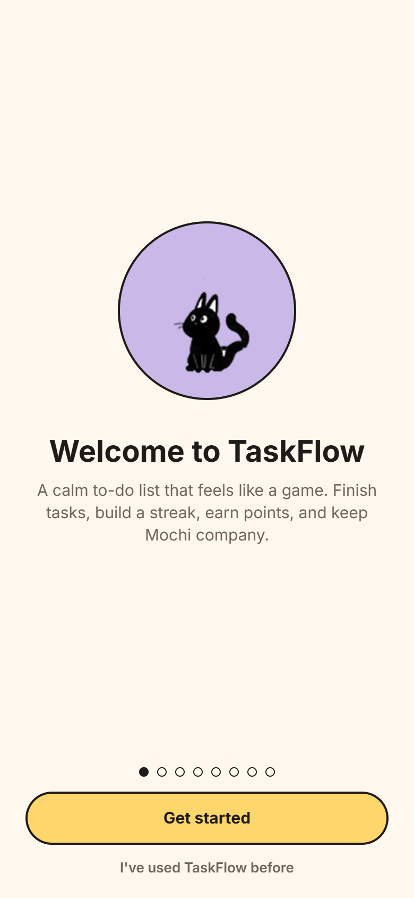
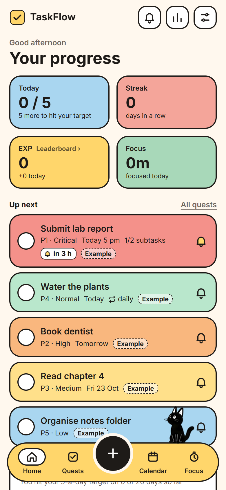
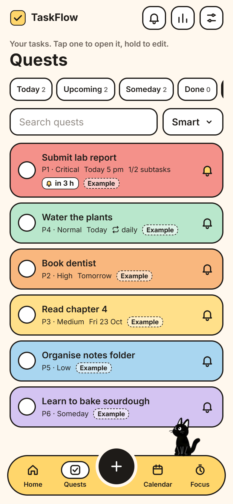
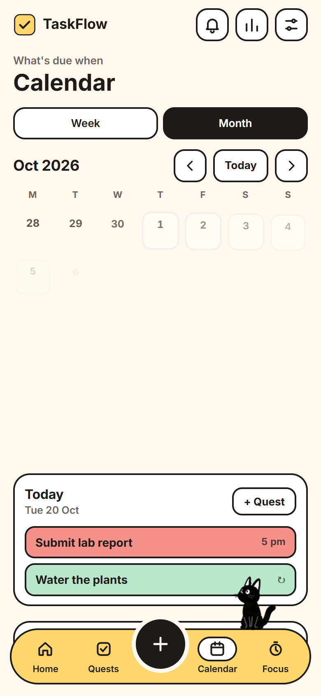
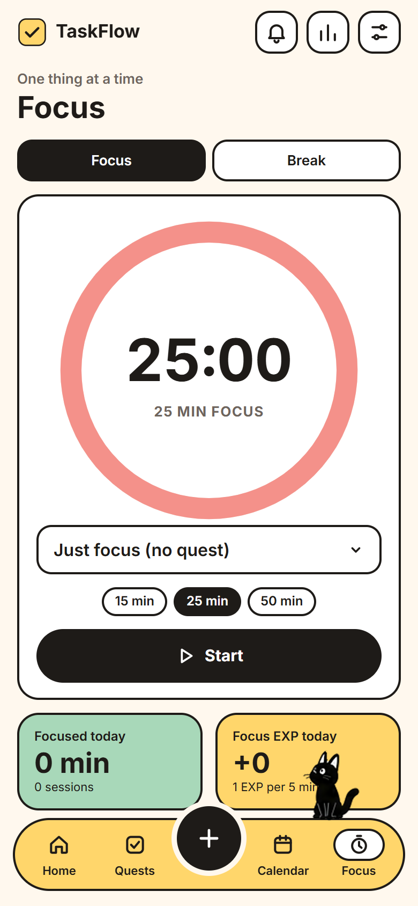
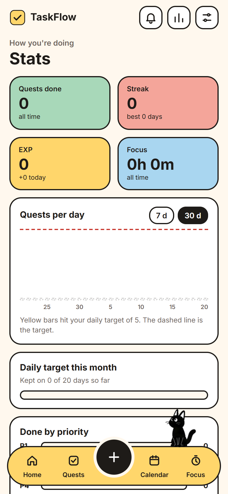
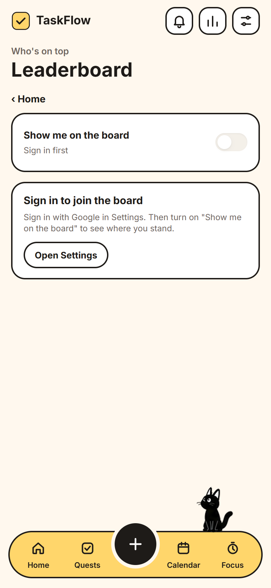

# TaskFlow

<p align="center">
  
</p>

A calm to-do list that feels like a game. Finish quests, build a streak, earn EXP, and keep Mochi the cat company as he walks along the bottom bar.

TaskFlow is an installable web app (PWA). It's plain HTML, CSS and ES modules, with no build step and no dependencies.

<p align="center">
  
  
  
  
  
  
</p>

## Features

- **Quests** with six priority colours, subtasks, repeats (daily, every other day, weekdays, weekly, monthly), and reminders.
- **Quick entry** that reads plain language: "water the plants every other day at 6pm" becomes a quest with a date, time, and repeat.
- **Daily nudges** for today's quests, water, meals, and walks, at times you choose.
- **Calendar** in month and week views, with Google Calendar sync and a downloadable `.ics` file.
- **Focus** timer that earns EXP for every five minutes.
- **Stats** for streaks, daily totals, priorities, and history.
- **Leaderboard** (opt-in) ranking people by EXP. Only a name and EXP are shared, and only when you turn it on.
- **Mochi**, the cat on the nav bar. He walks, naps, reacts to what you do, and can be picked up and dropped anywhere along the bar.
- **Works offline** once installed, and your data stays on the device unless you sign in to sync it.

## Run it locally

```bash
npm start            # serves the app at http://localhost:5190
npm test             # unit tests (dates, parsing, repeats, calendar export, stats)
npm run test:pwa     # headless Edge/Chrome check: service worker, offline, install, notifications
```

Open the app through the server, not as a file, because service workers need `localhost` or HTTPS. You need Node.js installed.

## Project layout

| Path | What's there |
|---|---|
| `app/` | The web app: `index.html`, `css/`, `js/` (views in `js/views/`), icons, sounds |
| `app/mochi/` | Mochi's animation manifest and sprite strips, copied from `design/` |
| `server.mjs` | Local server: serves `app/`, the sync API, and the calendar feed |
| `functions/` | Firebase Cloud Functions for the shared backend |
| `firestore.rules` | Security rules for the shared Firebase project |
| `design/` | Design brief, palette, and Mochi animation source files |
| `docs/screenshots/` | Screenshots used on this page |
| `scripts/` | Helpers, including `sync-mochi.mjs` to re-copy Mochi's art |

For the full feature table, the onboarding and tour details, and the settings reference, see [`app/README.md`](app/README.md).

## Deploying

The web app is hosted on Firebase Hosting from `app/`:

```bash
firebase deploy --only hosting --project <your-project>
```

Firestore rules are shared with another app in the same Firebase project, so they're deployed from that app's repository. Keep `firestore.rules` in step with that copy.

## Status

TaskFlow is an early version (v0.1). See [`app/README.md`](app/README.md) for the feature reference.
